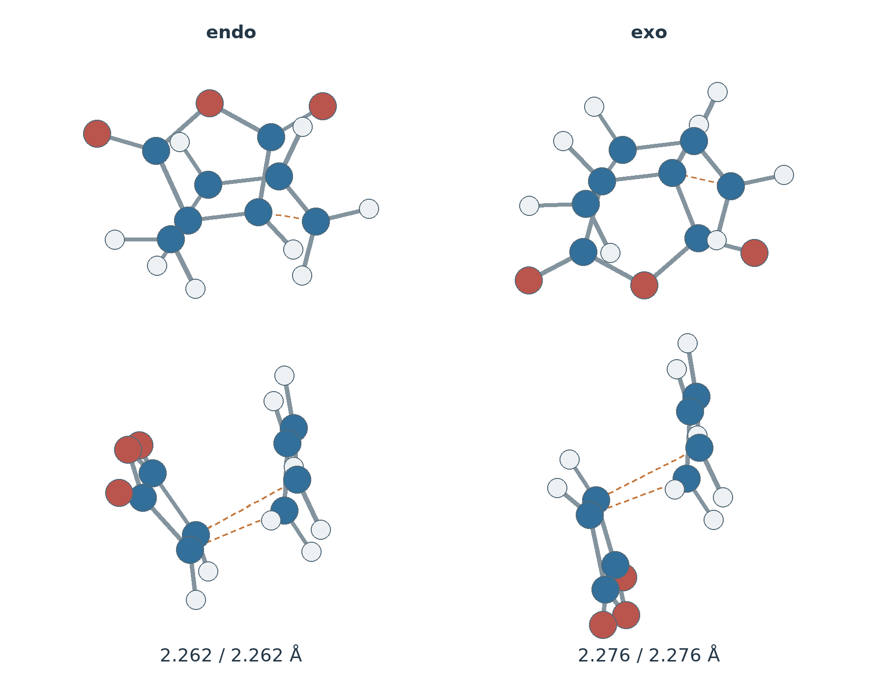
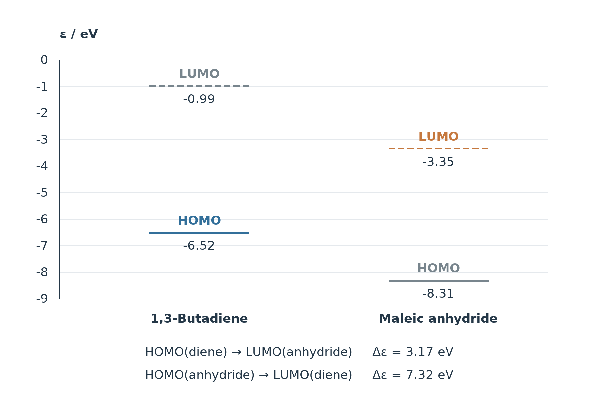
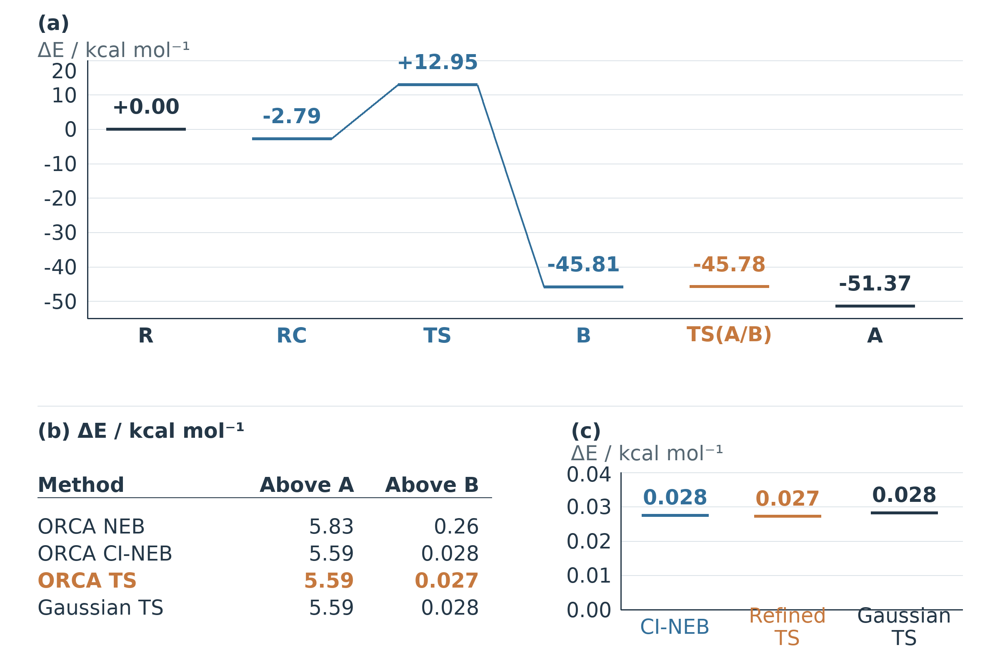
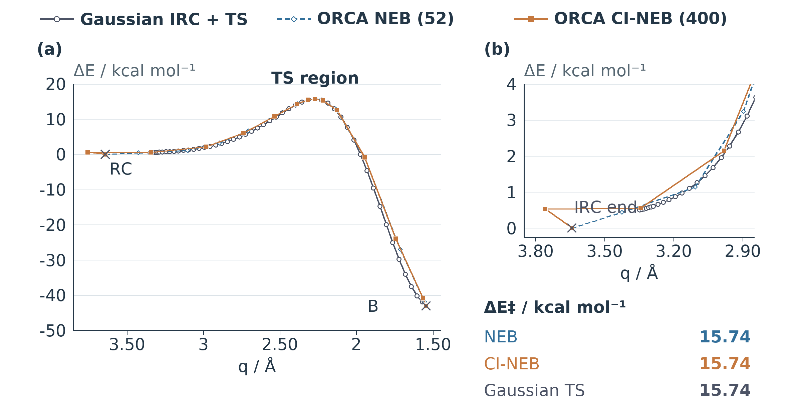
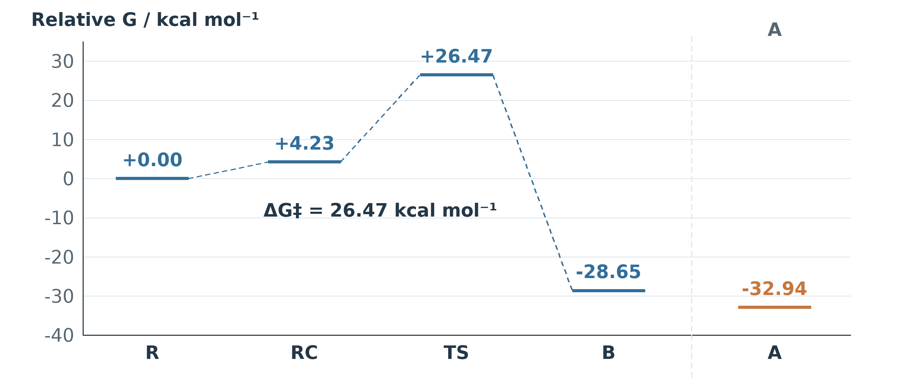

# Quantum3：环加成反应的机理研究

B3LYP-D3(BJ)/def2-SVP 气相计算：环加成过渡态、双向 IRC、NEB/CI-NEB 对照，以及环己烯 A/B 构象转化。

- [在线阅读实验报告 PDF](experiment-report/cycloaddition_mechanism.pdf)
- [直接下载 PDF](https://github.com/populuscathayana/Quantum3/raw/refs/heads/main/experiment-report/cycloaddition_mechanism.pdf)
- [LaTeX 源码](experiment-report/cycloaddition_mechanism.tex)
- [环境与复现步骤](ENVIRONMENT.md) · [后处理范围](POSTPROCESS.md) · [数据与第三方说明](THIRD_PARTY_NOTICES.md)

相关实验：[Quantum1](https://github.com/populuscathayana/Quantum1) · [Quantum2](https://github.com/populuscathayana/Quantum2) · [Quantum4](https://github.com/populuscathayana/Quantum4)

## 2026-10-23 成果更新

新版 LaTeX 源码已加入丁二烯＋顺丁烯二酸酐 endo/exo 的 Gaussian／ORCA 驻点对照、热化学、轨道正侧视图和两反应体系汇总表。正文末尾“数据与代码”节采用与 Quantum4 相同的无编号标题、说明文字及独立链接，封面不加仓库链接。

**PDF 版本：上方 PDF 仍为 2026-10-19 的 15 页版本，不包含本次新增酸酐结果。** 新版以当前 `.tex`、图表及数据为准；本次不以旧 PDF 冒充新版。源码可用配置好中文字体的 XeLaTeX 编译。

- [酸酐各自与并排对照动画索引（下载后浏览器打开）](experiment-report/maleic-media.html)
- [endo/exo 能量与自由能数据](analysis/maleic-endo-exo-20261022/endo-exo-energy-comparison.json)
- [HOMO／LUMO 能级数据](analysis/maleic-orbitals-20261021/levels.json)
- [新成果审核清单](data/publication-20261023.json)
- [后处理源码与复核说明](scripts/maleic-source/README.md)

| Gaussian 相同分离反应物参照 | 乙烯 | 酸酐 endo | 酸酐 exo |
|---|---:|---:|---:|
| 电子能垒 / kcal mol⁻¹ | 12.95 | 2.55 | 4.99 |
| 活化自由能 / kcal mol⁻¹ | 26.47 | 17.16 | 19.28 |
| 成键虚频 / cm⁻¹ | 517.2i | 443.0i | 446.3i |

自由能为 298.15 K、1 atm 下经转动对称数修正的 RRHO 值。酸酐 exo 栏为过渡态结果，不据此指定其产物连接；完整 endo Gaussian IRC 数据单独保留。轨道等值面来自真实波函数，虚频动画展示模式位移而非时间动力学。





## 主要结果

| 结果 | 数值 |
|---|---:|
| 环加成普通 NEB 电子势垒，以弱复合物为参考 | 15.7360 kcal/mol |
| 环加成 CI-NEB 电子势垒，以弱复合物为参考 | 15.7381 kcal/mol |
| Gaussian 环加成 TS 电子势垒，以弱复合物为参考 | 15.7407 kcal/mol |
| Gaussian 双分子活化自由能，298.15 K、1 atm | 26.4693 kcal/mol |
| ORCA 环扭转精修鞍点相对 A / B 的电子能高度 | 5.5907 / 0.0272 kcal/mol |
| ORCA 环扭转精修鞍点唯一虚频 | 67.56i cm⁻¹ |

环加成 IRC 连接弱结合反应物复合物与环己烯 B。A 是更稳定的独立构象；构象 CI-NEB 已收敛，双向构象 IRC 未完成并已停止。各程序分别使用自身能量参考，自由能以两个分离反应物为基准。

## 能量与路径







[完整 IRC 动画](experiment-report/figures/irc-full-path.gif) · [环加成 TS 虚频](experiment-report/figures/ts-imaginary-mode.gif) · [CI-NEB 峰顶虚频](experiment-report/figures/cineb-ci400-imaginary-mode.gif)

## 快速复现

离线后处理不需要 Gaussian、ORCA 或集群连接，不启动新的量子计算。

```bash
git clone https://github.com/populuscathayana/Quantum3.git
cd Quantum3
python3 -m venv .venv
source .venv/bin/activate
python -m pip install -r requirements.txt

# 核对已有计算结果及报告数据
python reproduce.py --check-only

# 同时重绘能量与路径图
python reproduce.py
```

派生图写到 `build/figures/`，计算文件和报告保持原样。具体环境及报告排版步骤见 [ENVIRONMENT.md](ENVIRONMENT.md)。

## 文件结构

| 目录 | 内容 |
|---|---|
| `experiment-report/` | 报告 PDF、TeX、11 幅报告图及 3 个动画 |
| `data/calculations/gaussian/` | 驻点、环加成 IRC 的输入/输出；驻点格式化检查点 |
| `data/calculations/orca/` | 环加成峰顶及构象 A/B/TS 的数值频率、Hessian、梯度和 TS 优化结果 |
| `data/manifest.json` | 科学文件的大小及 SHA256 清单 |
| `analysis/` | 热化学表、完整 IRC 点、NEB/CI-NEB 路径、结构及对照数据 |
| `scripts/` | 数据核对与移植后的绘图程序 |

数据索引见 [analysis/README.md](analysis/README.md)。公开输出只隐去机器路径等元数据，科学数值与软件声明保留。软件安装包、服务器连接、调度记录、二进制检查点和中间力调用文件不随仓库分发。
